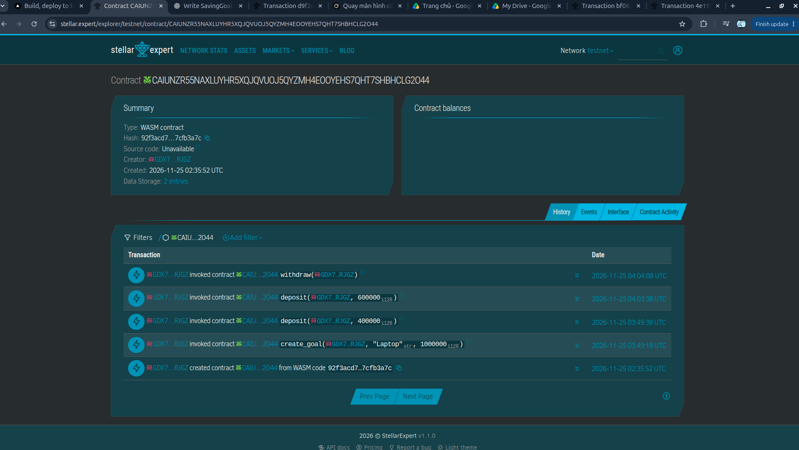

## Project Title

**Saving Goal Smart Contract (`SavingGoalContract`)**

## Project Description

`SavingGoalContract` is a Stellar Soroban smart contract written in Rust (`#![no_std]`) for creating and tracking personal saving goals on-chain. Each user `Address` can maintain one active `SavingGoal` stored in Soroban persistent storage (`DataKey::Goal(Address)`), containing the goal `name`, `target` amount, `saved` amount, `withdrawn` status, and `created_at` ledger timestamp.

The contract enforces user authorization on state-changing operations and restricts completion (`withdraw`) until the recorded `saved` balance reaches or exceeds `target`. In its current version, `deposit` and `withdraw` track `i128` balance state in contract storage rather than transferring on-chain tokens.

## Project Vision

The goal of this project is to provide a simple, transparent, and disciplined on-chain saving-goal tracker on Stellar. By locking the completion state until a target amount is reached and making goal progress publicly verifiable via `get_goal`, the contract establishes a foundational building block for goal-based personal finance on Soroban.

## Key Features

- **Create a Saving Goal (`create_goal`)**
  - Requires authorization from `user` (`user.require_auth()`).
  - Validates that `name` is non-empty (`Error::InvalidName`) and `target > 0` (`Error::InvalidTarget`).
  - Prevents creating a new goal if the user already has an open, unwithdrawn goal (`Error::GoalAlreadyOpen`). Once a goal has been withdrawn, a new goal can be created for that address.
  - Initializes `saved` to `0`, `withdrawn` to `false`, and `created_at` to `env.ledger().timestamp()`.

- **Deposit Toward a Goal (`deposit`)**
  - Requires authorization from `user` (`user.require_auth()`).
  - Validates that `amount > 0` (`Error::InvalidDeposit`).
  - Ensures the user has an existing goal (`Error::GoalNotFound`) that has not yet been withdrawn (`Error::GoalAlreadyWithdrawn`).
  - Safely adds `amount` to `saved` using `checked_add`, returning `Error::AmountOverflow` on arithmetic overflow.

- **Target-Gated Withdrawal (`withdraw`)**
  - Requires authorization from `user` (`user.require_auth()`).
  - Ensures the goal exists (`Error::GoalNotFound`) and has not already been withdrawn (`Error::GoalAlreadyWithdrawn`).
  - Enforces that `saved >= target` (`Error::TargetNotReached`).
  - Marks `withdrawn = true`, updates persistent storage, and returns the saved `i128` amount.

- **Public Goal Lookup (`get_goal`)**
  - Allows anyone to read the `SavingGoal` struct for a given `user` `Address`, returning `Error::GoalNotFound` if no goal exists.

- **Structured Error Codes**
  - Defines typed `Error` variants (`GoalAlreadyOpen = 1`, `InvalidName = 2`, `InvalidTarget = 3`, `GoalNotFound = 4`, `InvalidDeposit = 5`, `GoalAlreadyWithdrawn = 6`, `TargetNotReached = 7`, `AmountOverflow = 8`).

## Usage Instructions

**Prerequisites**

- Rust `1.84` or newer with the `wasm32v1-none` target:
  ```sh
  rustup target add wasm32v1-none
  ```
- [Stellar CLI](https://developers.stellar.org/docs/tools/developer-tools/cli/install-cli)

**Build**

From the project root:

```sh
stellar contract build
```

This compiles the contract to `target/wasm32v1-none/release/hello_world.wasm`.

**Deploy (Testnet)**

```sh
stellar contract deploy \
  --wasm target/wasm32v1-none/release/hello_world.wasm \
  --source-account <identity> \
  --network testnet \
  --alias saving-goal
```

**Invoke Contract Functions**

1. **Create a goal:**
   ```sh
   stellar contract invoke \
     --id <contract-id-or-alias> \
     --network testnet \
     --source-account <identity> \
     -- create_goal \
     --user <user-address> \
     --name "Emergency Fund" \
     --target 1000
   ```

2. **Deposit toward the goal:**
   ```sh
   stellar contract invoke \
     --id <contract-id-or-alias> \
     --network testnet \
     --source-account <identity> \
     -- deposit \
     --user <user-address> \
     --amount 500
   ```

3. **View goal progress:**
   ```sh
   stellar contract invoke \
     --id <contract-id-or-alias> \
     --network testnet \
     --source-account <identity> \
     -- get_goal \
     --user <user-address>
   ```

4. **Withdraw once the target is reached:**
   ```sh
   stellar contract invoke \
     --id <contract-id-or-alias> \
     --network testnet \
     --source-account <identity> \
     -- withdraw \
     --user <user-address>
   ```

## Future Scope

- **Real Token Transfers**: Integrate Stellar Asset Contract (SAC) token transfers (`soroban_sdk::token::Client`) on `deposit` and `withdraw` so funds are actually escrowed and released by the contract.
- **Multiple Goals per User**: Extend storage keys (for example, goal IDs per user) to allow users to manage multiple concurrent saving goals.
- **Deadlines & Flexible Rules**: Support optional target deadlines, partial withdrawals, or early-withdrawal mechanisms.
- **Contract Events**: Emit Soroban events for `create_goal`, `deposit`, and `withdraw` to support off-chain indexing and notifications.
- **Storage TTL Management**: Explicitly extend persistent storage time-to-live (`extend_ttl`) when goals are created or updated.
- **Automated Tests & Frontend**: Add host-side unit tests in `contracts/hello-world/src/test.rs` and build a web frontend for user interaction.

## Technology Stack

- **Smart Contract Language**: Rust (`edition = "2021"`, `#![no_std]`)
- **Platform & SDK**: Stellar Soroban (`soroban-sdk` v29)
- **Compilation Target**: `wasm32v1-none`
- **Build & Deployment Tooling**: Cargo, Stellar CLI

## Contract Detail

- **Contract ID:** `<CONTRACT_ID>`
- **Deployer:** `<DEPLOYER_ADDRESS>`


